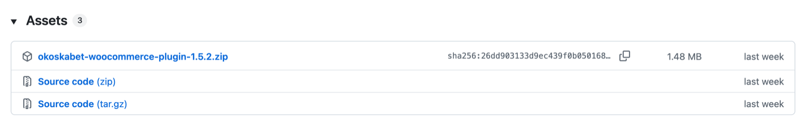
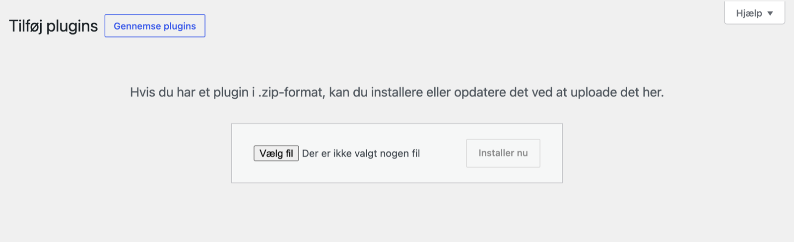
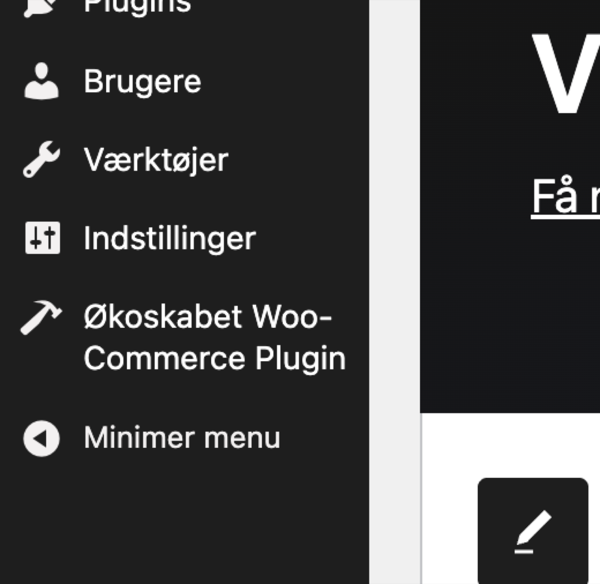

# Installation

Denne del af guiden handler om at få Økoskabets plugin ind i din WooCommerce-butik og holde det opdateret. Den næste del forklarer, hvordan du forbinder butikken med Økoskabet.

Guiden beskriver pluginet, som det ser ud i version 1.5.3. Funktioner og indstillinger, der er kommet til efter version 1.4.2, er markeret med den version, de kom i, for eksempel **Fra version 1.5.0**. Har din butik en ældre version, finder du ikke de ting, før du har opdateret. Står der ingen version, findes det i 1.4.2 og alle nyere versioner.

## Hvilken version har I?

Gå til **Plugins** i WordPress. Under **Økoskabet WooCommerce Plugin** står der for eksempel **Version 1.5.2**. Er der en nyere version, står der også en besked om det med et link til at opdatere.

Det kom i de enkelte versioner:

- **1.4.0**: flere Økoskabet-konti i samme butik.
- **1.4.3**: butiksafhentning, fragttrappe, regler for tidligere bestillingsfrist og styring af, hvor mange leveringsdage kassen viser.
- **1.4.6**: emballagegebyr og kuponer med gratis emballage.
- **1.4.7**: oversigten over jeres funktioner og priser hos Økoskabet.
- **1.5.0**: forudbestilling, leveringsundtagelser der kan vendes om, opdelt levering med to valg til kunden, fragt i egen række og bestilling til postnumre uden leveringsdage.
- **1.5.1**: en periode kan gøres til forudbestilling.
- **1.5.2**: rettelse, så datovælgeren altid kommer frem for nye kunder.
- **1.5.3**: adresseforslag i kassen, felt til lejlighed, etage og dør, tillæg til en tidligere ordre, rettelser fra Økoskabets backoffice skrives tilbage på ordren, Kontakt fra Økoskabet, og kun ordrer med Økoskabets fragt sendes til Økoskabet.

## Det skal din butik have

- WordPress 6.0 eller nyere.
- WooCommerce 7.0 eller nyere.
- PHP 8.1 eller nyere. Din webhost kan fortælle dig, hvilken version du har.
- HTTPS, altså en adresse der starter med https://. Økoskabet sender ikke statusbeskeder til en butik uden.

Mangler et af kravene, slår pluginet sig selv fra lige efter aktiveringen og skriver øverst i kontrolpanelet, hvad der mangler. Der sker ikke noget med butikken.

## Hent pluginet

Pluginet hentes som en zip-fil fra Økoskabets side på GitHub. Du skal ikke være logget ind.

1. Gå til [udgivelserne på GitHub](https://github.com/okoskabet/okoskabet-woocommerce-plugin/releases).
2. Find den øverste udgivelse. Den er den nyeste.
3. Under **Assets** klikker du på filen, der hedder `okoskabet-woocommerce-plugin-` efterfulgt af versionsnummeret og `.zip`, for eksempel `okoskabet-woocommerce-plugin-1.5.2.zip`.
4. Gem filen på din computer. Du skal ikke pakke den ud.

### Tag ikke "Source code"

Under hver udgivelse ligger der også to filer, som GitHub selv laver: **Source code (zip)** og **Source code (tar.gz)**. Dem skal du ikke bruge. Det samme gælder den grønne **Code**-knap og alt, der hedder `main`.

Grunden er mappens navn. WordPress lægger pluginet i en mappe med samme navn som mappen inde i zip-filen. Den rigtige zip indeholder mappen `okoskabet-woocommerce-plugin`. GitHubs egne filer indeholder en mappe med et andet navn, for eksempel `okoskabet-woocommerce-plugin-1.5.2` eller `okoskabet-woocommerce-plugin-main`. Så kan WordPress ikke genkende pluginet, når der kommer en opdatering. Du ender med to udgaver ved siden af hinanden, eller med en udgave der aldrig bliver opdateret.

`main` er desuden der, hvor ændringer samles, før de er færdige. Den kan indeholde ting, der ikke er gennemgået.

## Installér og aktivér

1. Log ind i WordPress som administrator.
2. Gå til **Plugins → Tilføj plugin**. I ældre udgaver af WordPress hedder punktet **Tilføj nyt**.
3. Klik på knappen **Upload plugin** øverst på siden.
4. Vælg zip-filen, du hentede, og klik **Installer nu**.
5. Når WordPress er færdig, klikker du **Aktiver plugin**.

Nu står **Økoskabet WooCommerce Plugin** i menuen i venstre side af kontrolpanelet. Det er her, alle pluginets egne indstillinger ligger.

Pluginet gør ikke noget i kassen, før det har fået en API-nøgle. Fortsæt med næste del: Forbind til Økoskabet.

## Opdateringer

Du skal ikke hente nye zip-filer selv. Når Økoskabet udgiver en ny version, tilbyder WordPress den på samme måde som alle andre plugins:

- Under **Kontrolpanel → Opdateringer**.
- På **Plugins**-siden, hvor der står, at en ny version er klar.

WordPress kigger efter nye versioner cirka to gange i døgnet. Vil du se efter med det samme, så klik **Tjek igen** under **Kontrolpanel → Opdateringer**.

Har du slået automatiske opdateringer til for plugins, opdaterer pluginet sig også selv.

Dine indstillinger, leveringsregler og alt andet, du har sat op, ligger i databasen. De bliver der ved en opdatering. De bliver der også, hvis du deaktiverer og sletter pluginet og installerer det igen.

## Skift fra en gammel installation

Er pluginet engang installeret fra en "Source code"-fil eller fra `main`, så ligger det i en mappe med et forkert navn. Det får aldrig opdateringer. Sådan skifter du:

1. Hent den rigtige zip som beskrevet ovenfor.
2. Gå til **Plugins**, deaktivér den gamle udgave og slet den.
3. Installér og aktivér den rigtige zip.

Dine indstillinger bliver liggende, så du skal ikke sætte noget op igen.
