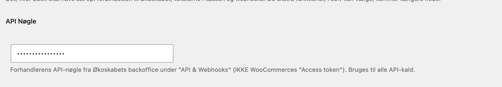
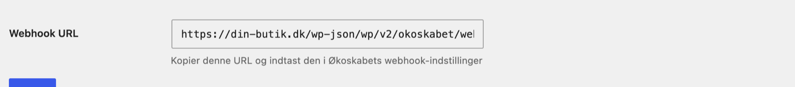
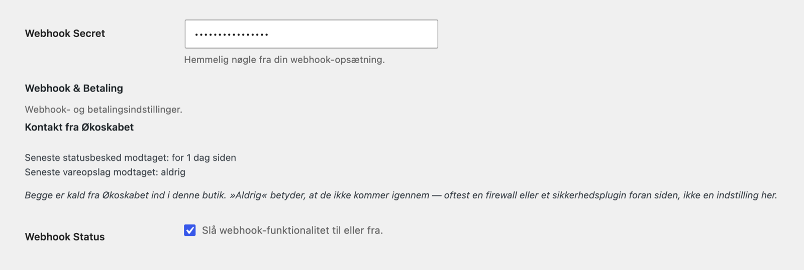
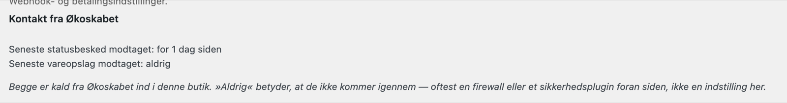

# Forbind til Økoskabet

Butikken og Økoskabet skal kunne tale sammen begge veje:

- **Butikken kalder Økoskabet**, når kassen henter skabe og leveringsdage, og når en ordre sendes. Det kræver en API-nøgle.
- **Økoskabet kalder butikken**, når en forsendelse skifter status, for eksempel når kunden har fået varerne. Det kaldes en webhook, og den kræver en webhook-adresse og en hemmelig nøgle (webhook secret).

Du sætter begge dele op én gang. Det tager et kvarter.

Alle felterne nævnt her er forklaret enkeltvis i delen Indstillinger. Hvordan du finder tingene i Økoskabets backoffice, står i backoffice-delen af guiden.

## 1. Find API-nøglen i Økoskabets backoffice

1. Log ind i Økoskabets backoffice.
2. Gå til **Indstillinger → API & webhooks**.
3. Kopiér butikkens API-nøgle.

Brug ikke WooCommerces egen "Access token" eller nøgler fra **WooCommerce → Indstillinger → Avanceret → REST API**. De er til noget andet og virker ikke her.

## 2. Sæt API-nøglen ind i pluginet

1. Gå til **Økoskabet WooCommerce Plugin** i venstremenuen i WordPress.
2. Sæt nøglen ind i feltet **API Nøgle** øverst under **Standardindstillinger**.
3. Klik på gem-knappen under formularen.



Nu kan kassen hente skabe og leveringsdage. Økoskabets fragtmetoder kan også lægges i dine forsendelseszoner. Det står i delen Fragtmetoder.

Feltet **Staging API** står i pluginets indstillinger, men er skjult på siden. Det peger pluginet mod Økoskabets testmiljø og bruges kun, når Økoskabet selv tester. En almindelig butik skal ikke bruge det. En nøgle fra testmiljøet virker ikke i det almindelige miljø, og omvendt.

## 3. Kopiér webhook-adressen

Længere nede på siden, under **Webhook & Betaling**, står feltet **Webhook URL**. Det kan ikke redigeres. Det viser den adresse, Økoskabet skal sende statusbeskeder til. Den ser sådan ud, med din egen butiks adresse forrest:

```
https://dinbutik.dk/wp-json/wp/v2/okoskabet/webhook
```

Kopiér hele adressen.



## 4. Registrér webhooken i backoffice og hent den hemmelige nøgle

1. Gå tilbage til **Indstillinger → API & webhooks** i Økoskabets backoffice.
2. Indsæt webhook-adressen fra pluginet.
3. Backoffice giver dig en hemmelig nøgle (webhook secret). Kopiér den.

Detaljerne står i backoffice-delen af guiden.

## 5. Sæt den hemmelige nøgle ind i pluginet

1. Gå tilbage til pluginets indstillinger.
2. Sæt nøglen ind i feltet **Webhook Secret**.
3. Se efter, at der er flueben i **Webhook Status**. Det er der som standard.
4. Gem.

Pluginet bruger den hemmelige nøgle til at tjekke, at en statusbesked virkelig kommer fra Økoskabet. En besked med en forkert eller manglende underskrift bliver afvist. Derfor skal nøglen i pluginet være præcis den samme som i backoffice.



## 6. Tjek at Økoskabet kan nå butikken

**Fra version 1.5.3.**

Under **Webhook & Betaling** står **Kontakt fra Økoskabet** med to linjer:

- **Seneste statusbesked modtaget** — sidste gang en statusbesked om en forsendelse kom igennem til butikken med en rigtig underskrift.
- **Seneste vareopslag modtaget** — sidste gang Økoskabets pakkeri slog butikkens varer op. Pakkeriet gør det for at få varernes egenskaber med på følgesedlen. Adressen sendes automatisk med hver ordre, så det skal du ikke sætte op.

Der står enten hvor længe siden, for eksempel "for 2 timer siden", eller **aldrig**.

**Aldrig** betyder, at Økoskabets kald ikke kommer igennem til butikken. Det er sjældent en indstilling i pluginet. Oftest er det en firewall, Cloudflare eller et sikkerhedsplugin foran hjemmesiden, der stopper kaldet, før WordPress ser det. Pluginet kan ikke se et kald, der aldrig når frem, så det kan kun fortælle dig, hvornår der sidst kom et igennem.

Lige efter opsætningen står der naturligt **aldrig**, indtil den første ordre har skiftet status hos Økoskabet. Står der stadig aldrig, efter at en ordre er udleveret, så se delen Fejlfinding.



## 7. Vælg hvad statusbeskederne skal gøre

Statusbeskederne kan hæve betalingen og markere ordren som gennemført. Det vælger du under **Betalingsgateway**, **Capture-events** og **Completion-events**. Standardvalgene passer til de fleste butikker:

- Betalingen hæves, når etiketten er printet.
- Ordren markeres som gennemført, når kunden har fået varerne (trinnet Udleveret).

Felterne er forklaret i delen Indstillinger, og hvad der sker med ordrerne, står i delen Kassen og ordrer.

## Flere Økoskabet-konti i samme butik

Nederst under standardindstillingerne står linket **+ Tilføj endnu en Økoskabet-merchant**. Det er kun til butikker, der sender varer fra flere Økoskabet-konti, for eksempel to lagre. Klikker du på det, vises en tabel over butikkens konti. Det ændrer ikke noget, før du gemmer en konto mere. Fra da af flytter API-nøgle, webhook secret og betalingsvalg fra hovedformularen over i tabellen, og hver konto får sin egen webhook-adresse. Det er forklaret under Flere Økoskabet-konti i delen Indstillinger. Har butikken én konto, skal du ikke røre linket.
