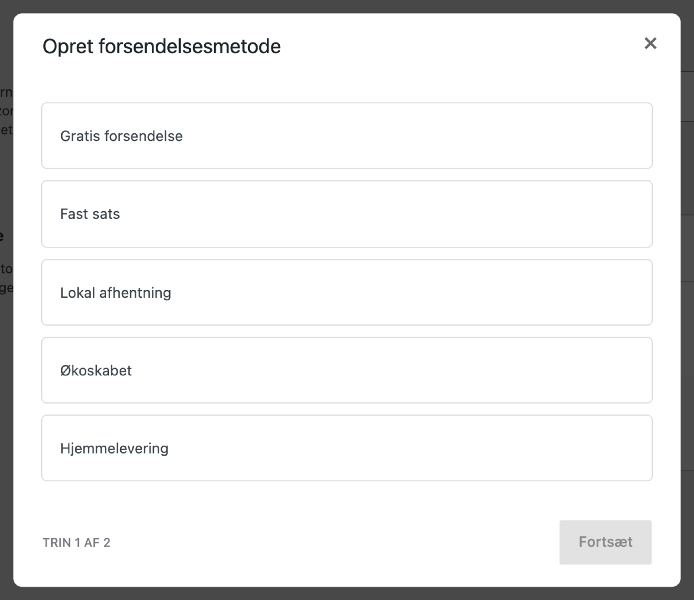
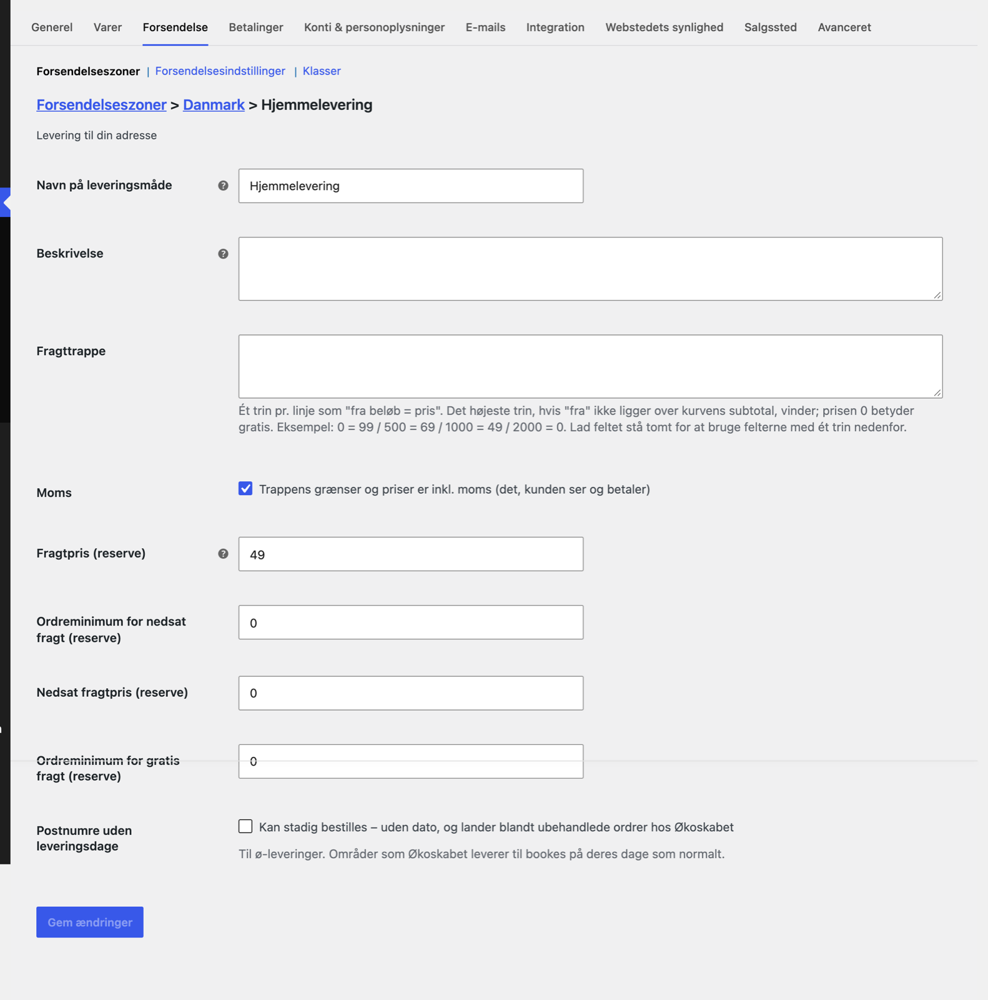

# Fragtmetoder

Kunden vælger levering med Økoskabet på samme måde som al anden fragt i WooCommerce: som en fragtmetode i kassen. Pluginet har tre fragtmetoder:

- **Økoskabet** — levering til et af Økoskabets køleskabe. Kunden vælger skab og leveringsdato.
- **Hjemmelevering** — levering til kundens adresse. Kunden vælger leveringsdato.
- **Butiksafhentning** — kunden henter selv varerne i din butik. Kunden vælger afhentningssted og afhentningsdato.

Det er kun ordrer med en af de tre fragtmetoder, der bliver sendt til Økoskabet. Ordrer med butikkens andre fragtmetoder rører pluginet ikke.

## Kun de leveringstyper, du har hos Økoskabet

En fragtmetode kan kun vælges i WooCommerce, hvis din konto hos Økoskabet har den leveringstype slået til. Har du kun skabe hos Økoskabet, står Hjemmelevering og Butiksafhentning slet ikke på listen. Leveringstyperne slås til og fra i Økoskabets backoffice, ikke i pluginet.

Pluginet spørger Økoskabet, hvilke leveringstyper du har. Svaret huskes i fem minutter. Har Økoskabet lige slået en ny leveringstype til, kan der derfor gå op til fem minutter, før den står på listen. Gemmer du pluginets indstillinger, spørger pluginet igen med det samme.

Uden en API-nøgle i pluginet står ingen af de tre metoder på listen.

## Læg fragtmetoderne i en forsendelseszone

1. Gå til **WooCommerce → Indstillinger → Forsendelse**.
2. Åbn den forsendelseszone, du leverer i, for eksempel en zone der hedder Danmark. Har du ingen zoner, så opret en og tilføj Danmark som område.
3. Klik **Tilføj forsendelsesmetode**.
4. Vælg **Økoskabet**, **Hjemmelevering** eller **Butiksafhentning**, og bekræft.
5. Klik **Rediger** ud for metoden for at sætte navn og pris. Felterne er forklaret nedenfor.
6. Gentag for hver leveringstype, du vil tilbyde.



Du kan lægge den samme fragtmetode i flere zoner med hver sin pris. Det er nyttigt, hvis levering til for eksempel Bornholm skal koste noget andet end levering til resten af landet. Hver kopi har sine egne felter.

Hvilke skabe og datoer kunden kan vælge imellem, bestemmer Økoskabet ud fra kundens postnummer og adresse. Zonen bestemmer kun, om metoden står i kassen, og hvad den koster.



## Felterne på en fragtmetode

De tre fragtmetoder har de samme felter. Hjemmelevering har et felt mere til sidst.

Prisen kan sættes på to måder. Den nye måde er **Fragttrappen**, hvor du skriver en hel prisliste. Den gamle måde er de fire felter med **(reserve)** i navnet. De bruges kun, når fragttrappen er tom. Vælg den ene måde og lad den anden være.

<!-- setting: shipping:title -->
### Navn på leveringsmåde

Det navn, kunden ser ud for fragtmetoden i kurven og i kassen. Det står også på ordren og i ordremailen.

Standard: metodens eget navn, altså Økoskabet, Hjemmelevering eller Butiksafhentning. Skriv for eksempel "Levering til Økoskab" eller "Hjemmelevering i hele Danmark", hvis det siger mere for dine kunder.

Når fragten er gratis, sætter pluginet selv "(Gratis)" bag navnet.

<!-- setting: shipping:description -->
### Beskrivelse

Bruges kun på **Butiksafhentning**. Når kunden har valgt butiksafhentning, vises teksten under metoden i kassen. Skriv for eksempel butikkens åbningstider og hvor varerne hentes. Linjeskift bliver vist.

På Økoskabet og Hjemmelevering bliver feltet ikke vist nogen steder. Teksten over datovælgeren for de to metoder sætter du i stedet i pluginets egne indstillinger: **Økoskabet Beskrivelse (Ikke påkrævet)** og **Økoskabet Hjemmelevering Beskrivelse (Ikke påkrævet)**.

Standard: tom.

<!-- setting: shipping:tiers -->
### Fragttrappe

En prisliste, hvor fragten afhænger af, hvor meget kunden køber for. Skriv ét trin pr. linje som "fra beløb = pris":

```
0 = 99
500 = 69
1000 = 49
2000 = 0
```

Med den liste koster fragten 99 kr. under 500 kr., 69 kr. fra 500 kr., 49 kr. fra 1.000 kr. og er gratis fra 2.000 kr. Det højeste trin, kurven når op på, gælder. Prisen 0 betyder gratis fragt.

Beløbet, der sammenlignes med, er varernes pris efter rabat. Fragt og gebyrer tæller ikke med. Om det er med eller uden moms, bestemmer feltet **Moms** lige nedenunder.

Godt at vide:

- Du kan bruge komma som decimaltegn, for eksempel "500 = 49,50".
- En linje, der ikke er to tal, bliver sprunget over. En tastefejl giver altså ikke gratis fragt.
- Er kurven under det laveste trin, gælder prisen på det laveste trin.
- En rabatkode med **Tillad gratis forsendelse** giver altid gratis fragt.

Standard: tom. Så bruges felterne med (reserve).

<!-- setting: shipping:amounts_include_tax -->
### Moms

Fluebenet "Trappens grænser og priser er inkl. moms (det, kunden ser og betaler)".

Med flueben skriver du beløbene, som kunden ser dem. Grænserne sammenlignes med kurven inklusive moms, og prisen er det, kunden betaler. Pluginet regner selv momsen ud, så totalen lander præcis på dit tal.

Uden flueben er grænser og priser uden moms. WooCommerce lægger så momsen oven i prisen, hvis butikken opkræver moms af fragt.

Gælder kun fragttrappen, ikke felterne med (reserve). Standard: slået til, og det passer til de fleste butikker.

<!-- setting: shipping:cost -->
### Fragtpris (reserve)

Fragtprisen, når fragttrappen er tom. Prisen er uden moms, som WooCommerce normalt regner fragt. Er butikken sat op til moms på fragt, lægges momsen oveni.

Standard: 49 på Økoskabet og Hjemmelevering, 0 på Butiksafhentning. Butiksafhentning med prisen 0 vises som "(Gratis)".

<!-- setting: shipping:costDiscountLimit -->
### Ordreminimum for nedsat fragt (reserve)

Når kurven når op på dette beløb, koster fragten i stedet **Nedsat fragtpris (reserve)**, og kunden ser "(Nedsat fragtpris)" bag navnet. Beløbet sammenlignes med varernes pris uden moms.

Bruges kun, når fragttrappen er tom, og kun på Økoskabet og Hjemmelevering. Standard: 0, som betyder slået fra.

<!-- setting: shipping:costDiscount -->
### Nedsat fragtpris (reserve)

Prisen, når kurven har nået **Ordreminimum for nedsat fragt (reserve)**. Uden moms, som Fragtpris (reserve).

Standard: 0.

<!-- setting: shipping:costFreeLimit -->
### Ordreminimum for gratis fragt (reserve)

Når kurven når op på dette beløb, er fragten gratis. Beløbet sammenlignes med varernes pris uden moms. Gratis fragt vinder over nedsat fragt, hvis begge grænser er nået.

En rabatkode med **Tillad gratis forsendelse** giver også gratis fragt.

Bruges kun, når fragttrappen er tom, og kun på Økoskabet og Hjemmelevering. Standard: 0, som betyder slået fra.

<!-- setting: shipping:allow_without_date -->
### Postnumre uden leveringsdage

Findes kun på **Hjemmelevering**. Fluebenet "Kan stadig bestilles – uden dato, og lander blandt ubehandlede ordrer hos Økoskabet".

Lavet til ø-levering. Normalt kan en kunde ikke bestille hjemmelevering til et postnummer, hvor Økoskabet ikke kører. Med flueben kan kunden alligevel bestille:

- Postnumre, hvor Økoskabet kører, bookes på deres dage som normalt.
- Et postnummer uden leveringsdage får beskeden "Leveringsdagen aftales efter bestillingen – vi kontakter dig." i stedet for en datovælger.
- Ordren sendes til Økoskabet uden dato og lander blandt de ubehandlede ordrer i backoffice. Der får den en dato i hånden.

Sæt det kun på den kopi af Hjemmelevering, der ligger i zonen med øerne, så resten af landet stadig skal vælge en dato. Standard: slået fra.

## Tillægsordrer koster ingen fragt

**Ny i 1.5.3.** Når en kunde lægger varer til en tidligere ordre, sætter pluginet prisen på Økoskabets tre fragtmetoder til 0, fordi varerne kører med den levering, der allerede er betalt. Butikkens egne fragtmetoder beholder deres pris. Det er forklaret i delen Kassen og ordrer.
