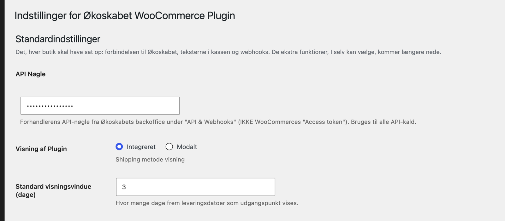
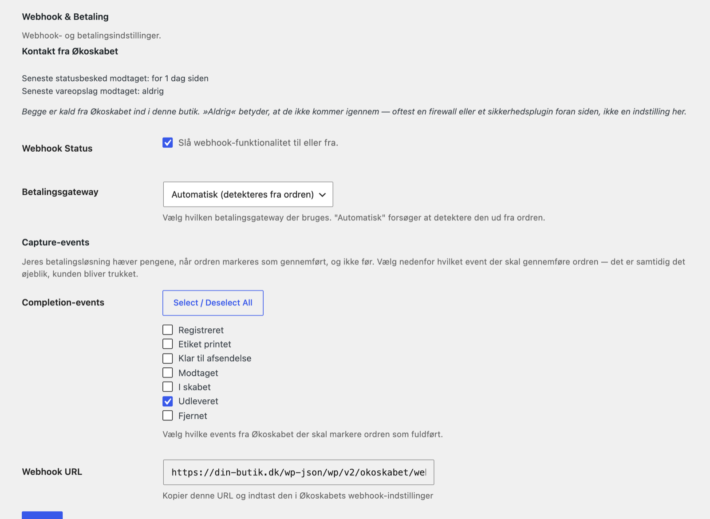
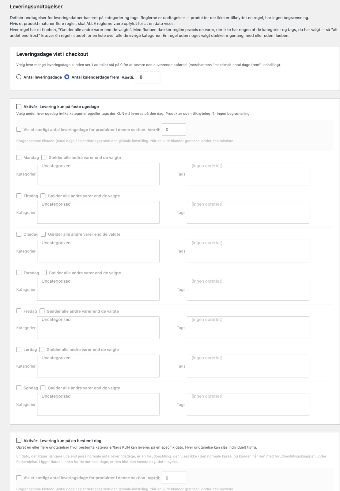
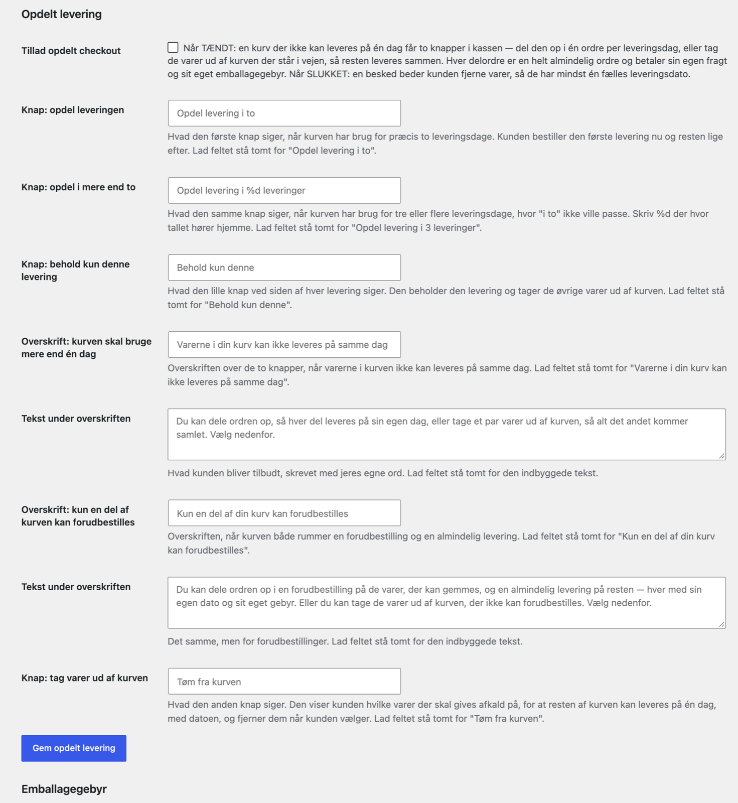
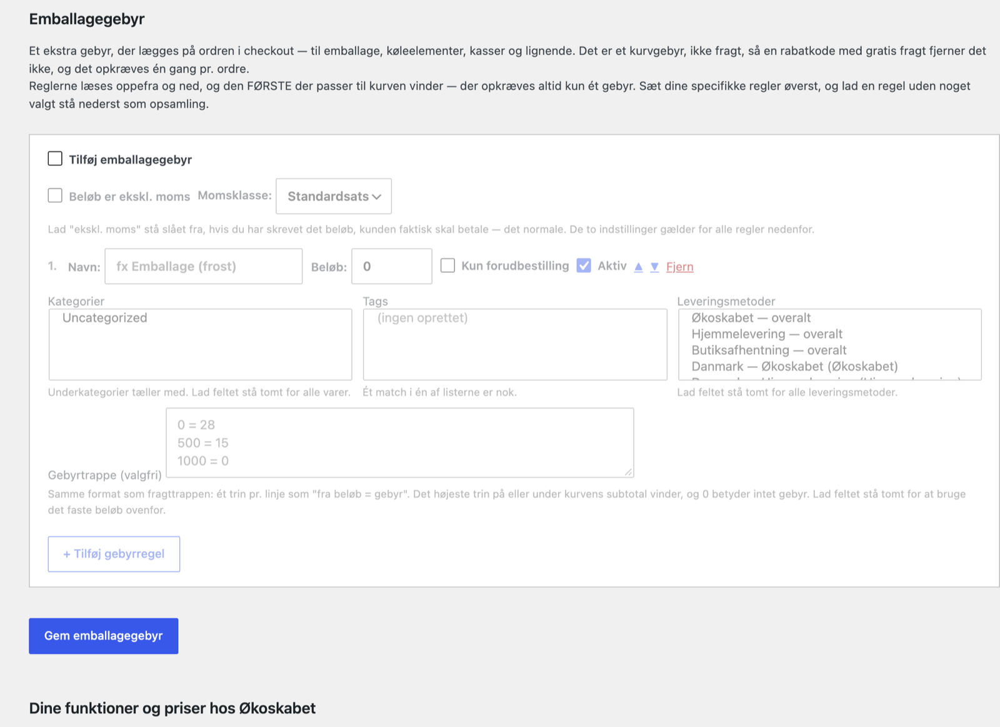

# Indstillinger

Alle pluginets egne indstillinger ligger på én side: **Økoskabet WooCommerce Plugin** i venstremenuen i WordPress. Siden har to dele:

- **Standardindstillinger** øverst. Det, alle butikker skal have: forbindelsen til Økoskabet, teksterne i kassen og webhooks. Hele den del gemmes med én knap nederst i formularen.
- **Ekstra funktioner** længere nede. Leveringsundtagelser, opdelt levering, emballagegebyr og en oversigt over dine priser hos Økoskabet. Hver funktion har sin egen boks og sin egen gem-knap. En gem-knap gemmer kun sin egen boks.

Alt nyt er slået fra, indtil du selv slår det til. En butik, der kun har udfyldt API-nøgle og webhook secret, fungerer fint.

Her er hvert felt forklaret i den rækkefølge, det står på siden. Et par felter findes et andet sted: på en rabatkupon og på et produkt. De står til sidst.

## Standardindstillinger

<!-- setting: _api_key -->
### API Nøgle

Butikkens nøgle til Økoskabet. Pluginet bruger den, hver gang det spørger Økoskabet om noget: skabe, leveringsdage, adresser og når en ordre sendes. Uden den viser kassen ingen leveringsvalg, og Økoskabets fragtmetoder kan ikke vælges.

Nøglen findes i Økoskabets backoffice under **Indstillinger → API & webhooks**. Det er ikke WooCommerces "Access token". Feltet viser prikker i stedet for nøglen.

Standard: tom.

<!-- setting: _display_option -->
### Visning af Plugin

Hvordan kunden vælger skab, når fragtmetoden Økoskabet er valgt.

- **Integreret**: listen over skabe, listen over leveringsdatoer og et kort står direkte i kassen.
- **Modalt**: kassen viser det valgte skab og den valgte dato og en knap, **Vælg Økoskab**. Knappen åbner et vindue med lister og kort.

Indstillingen påvirker kun skab-levering. Hjemmelevering og butiksafhentning ser ens ud i begge tilfælde.

Standard: Integreret.

<!-- setting: _maximum_days_in_future -->
### Standard visningsvindue (dage)

Hvor mange dage frem kassen viser leveringsdatoer. Med 3 kan kunden vælge blandt leveringsdagene i de næste tre dage.

Tallet har en ekstra betydning, hvis du bruger forudbestilling: en dag længere ude end dette tal er en forudbestilling. Den kan kun vælges med knappen Forudbestilling i kassen.

Har du regler om faste ugedage under Leveringsundtagelser, så skal vinduet være stort nok til at indeholde mindst én af de ugedage. Ellers er datolisten tom. Sæt det til 7–14 i så fald. Regler med en bestemt dato eller en periode udvider selv vinduet, så kunden altid ser datoen.

Standard: 3. Mindste værdi er 1.

<!-- setting: _staging_api -->
### Staging API

Får pluginet til at tale med Økoskabets testmiljø i stedet for det rigtige. Feltet er skjult på siden, fordi det kun bruges, når Økoskabet selv tester. En almindelig butik skal ikke bruge det.

Standard: slået fra.

<!-- setting: _description_shipping_okoskabet -->
### Økoskabet Beskrivelse (Ikke påkrævet)

Den lille tekst over skab-vælgeren i kassen, når kunden har valgt Økoskabet. Lader du feltet være tomt, står der "Afkølet afhentningssted hvor du kan hente dine varer hele døgnet vha. kode."

Standard: tom, altså standardteksten.

<!-- setting: _description_shipping_private -->
### Økoskabet Hjemmelevering Beskrivelse (Ikke påkrævet)

Den lille tekst over datovælgeren i kassen, når kunden har valgt Hjemmelevering. Lader du feltet være tomt, står der "Økoskabet leverer dine varer til døren."

Standard: tom, altså standardteksten.

## Hjemmelevering: Leveringssted

Felterne her handler om, hvor chaufføren skal stille varerne, når kunden har valgt hjemmelevering. Kassen viser en overskrift, en lille forklaring og en liste over steder. Kundens valg sendes til Økoskabet som besked til chaufføren.

<!-- setting: _delivery_location_dropdown -->
### Vis dropdown med leveringssteder

Med flueben viser kassen en liste med steder, Økoskabet har sat op, for eksempel ved hoveddøren eller ved trappen. Sidst på listen står **Andet**. Vælger kunden Andet, kommer der et tekstfelt frem, hvor kunden selv kan skrive.

Uden flueben viser kassen kun tekstfeltet.

Vælger kunden hverken et sted eller skriver noget, sendes ordren med "In front of the front door" (foran hoveddøren). Det er nyt i version 1.5.3.

Standard: slået til.

<!-- setting: _delivery_location_dropdown_label -->
### Label: Dropdown

Overskriften over listen i kassen. Lader du feltet være tomt, står der "Leveringssted".

Standard: Leveringsinfo.

<!-- setting: _delivery_location_note_label -->
### Beskrivende tekst

En kort forklaring, der står mellem overskriften og listen. For eksempel "Din ordre leveres natten til din leveringsdag".

Lader du feltet være tomt, står der "Besked til chaufføren (valgfrit)". Feltets egen hjælpetekst på siden siger, at teksten skjules, når feltet er tomt, men det er standardteksten, der vises.

Standard: tom, altså standardteksten.

<!-- setting: _hide_wc_order_comments -->
### Skjul WooCommerce ordrenote

Skjuler WooCommerces eget felt **Bemærkninger til ordren** i kassen, så kunden kun har ét sted at skrive en besked.

Fluebenet skjuler hele feltgruppen **Yderligere information** i hele kassen, uanset hvilken fragtmetode kunden vælger. Har et andet plugin lagt felter i den gruppe, forsvinder de også.

Lader du feltet være til, er intet tabt: en besked i WooCommerces felt sendes også med til Økoskabet, efter kundens leveringssted.

Standard: slået fra.

<!-- setting: _ask_for_floor -->
### Spørg om lejlighed, etage og dør

**Ny i 1.5.3.**

Tilføjer feltet **Lejlighed, etage og dør** lige under gadeadressen i kassen, både i faktura- og leveringsadressen. Feltet kommer kun, hvis kassen ikke allerede har en anden adresselinje.

Slå det til, hvis din kasse ikke har en anden adresselinje, og Økoskabet afviser adresser i etageejendomme, fordi etagen mangler.

Lad det være slået fra, hvis dine kunder skriver etagen på gadelinjen, for eksempel "Byagervej 194, 1. tv". Økoskabet læser etagen derfra. To steder at skrive det samme får nogle kunder til at skrive det to gange, og så bliver adressen afvist.

Standard: slået fra.

<!-- setting: _separate_shipping_methods -->
### Fragt i egen række

En liste over alle fragtmetoder i alle dine forsendelseszoner, skrevet som "Zone — metode". De metoder, du sætter flueben ved, flyttes i kassen ned i deres egen række under fragtvalgene, med en overskrift for sig.

Det er kun visning. Prisen og alt andet er det samme. Brug det til en fragtmetode, der ikke er en egentlig måde at sende på, for eksempel butikkens egen metode til tillæg til en tidligere ordre. Midt mellem de rigtige fragtvalg ligner den ellers en måde at sende hele ordren på.

Standard: ingen valgt.

<!-- setting: _separate_shipping_label -->
### Overskrift på rækken

Overskriften over rækken fra **Fragt i egen række**. Lader du feltet være tomt, står der "Andre muligheder".

Standard: tom, altså "Andre muligheder".

<!-- setting: _address_autocomplete -->
### Adresseforslag i kassen

**Ny i 1.5.3.**

Mens kunden skriver sin adresse, foreslår kassen rigtige adresser fra det danske adresseregister. Vælger kunden et forslag, udfyldes gade og husnummer, etage og dør, postnummer og by. Er adressen en ejendom med lejligheder, får kunden en liste mere, **Vælg lejlighed**, hvor man også kan vælge ingen lejlighed. Skabe og leveringsdage opdateres med det samme.

Det giver færre pakker til adresser, Økoskabet ikke kan finde. Kunden kan se bort fra forslagene og skrive som før. Kan adresseregistret ikke svare, viser kassen bare ingen forslag.

Forslagene hentes gennem din egen butik med din API-nøgle. Nøglen kommer aldrig ud til kundens browser.

Virker i WooCommerces klassiske kasse, ikke i blok-kassen.

Standard: slået fra.

<!-- setting: _webhook_secret -->
### Webhook Secret

Den hemmelige nøgle, Økoskabet underskriver sine statusbeskeder og vareopslag med. Pluginet tjekker underskriften og afviser alt, der ikke passer. Nøglen får du i Økoskabets backoffice, når du registrerer webhook-adressen. Den skal stå præcis ens begge steder.

Uden nøglen afviser butikken alle beskeder fra Økoskabet. Feltet viser prikker.

Standard: tom.

## Webhook & Betaling

Her bestemmer du, hvad der sker i butikken, når Økoskabet melder en ny status på en forsendelse.

### Kontakt fra Økoskabet

**Ny i 1.5.3.** Ikke et felt, men en status. Den viser, hvornår der sidst kom en statusbesked og et vareopslag fra Økoskabet igennem til butikken. Står der **aldrig**, når Økoskabets kald ikke frem. Oftest er det en firewall eller et sikkerhedsplugin foran hjemmesiden. Se delen Fejlfinding.

<!-- setting: _webhook_enabled -->
### Webhook Status

Hovedafbryderen for alt, Økoskabet sender til butikken: statusbeskeder og vareopslag. Med flueben tager butikken imod dem. Uden flueben afvises de alle sammen.

Slår du det fra, bliver ordrer ikke længere gennemført og betalinger ikke hævet af Økoskabet. Ændringer, Økoskabet laver i en levering, kommer heller ikke tilbage til butikken.

Standard: slået til.

<!-- setting: _payment_gateway -->
### Betalingsgateway

Hvilken betalingsløsning pluginet skal bede om at hæve betalingen, når et af dine **Capture-events** kommer. Valgene er **Automatisk (detekteres fra ordren)**, Quickpay, Stripe, Nets Easy / DIBS Easy, Pensopay og **Andet (skift status til "processing")**.

Automatisk læser betalingsmetoden på hver ordre. Det passer til næsten alle. Vælg kun noget andet, hvis Økoskabet beder dig om det.

Bankoverførsel, check og efterkrav forsøges aldrig hævet. De står som ubetalte, til du selv har set pengene.

Standard: Automatisk (detekteres fra ordren).

<!-- setting: _capture_events -->
### Capture-events

De trin i en forsendelse, hvor betalingen skal hæves. Listen hentes fra din konto hos Økoskabet og ser typisk sådan ud: Registreret, Etiket printet, Klar til afsendelse, Modtaget, I skabet, Udleveret og Fjernet.

Pluginet forsøger kun at hæve, hvis WooCommerce ikke allerede regner ordren for betalt. Resultatet skrives som en note på ordren.

Tager din betalingsløsning først pengene, når ordren er gennemført, som Nets Easy, står der en forklaring i stedet for listen. Så er det **Completion-events**, der bestemmer, hvornår kunden bliver trukket.

Standard: Etiket printet.

<!-- setting: _webhook_events -->
### Completion-events

De trin i en forsendelse, hvor ordren skal sættes til **Gennemført** i WooCommerce. WooCommerce sender så sin almindelige mail om, at ordren er gennemført. Listen er den samme som under Capture-events.

En ordre, der er annulleret, refunderet, mislykket eller ikke betalt, bliver ikke gennemført. Kommer trinnet, før betalingen er hævet, og kan et af dine Capture-events stadig hæve den, så venter pluginet og gennemfører ordren, når betalingen bliver hævet. Det står som en note på ordren.

Fjerner du alle flueben, gennemfører Økoskabet aldrig ordrer. Så gør du det selv.

Standard: Udleveret, altså når kunden har fået varerne.

<!-- setting: _webhook_url_display -->
### Webhook URL

Ikke et felt du udfylder. Det viser den adresse, Økoskabet skal sende statusbeskeder til, for eksempel `https://dinbutik.dk/wp-json/wp/v2/okoskabet/webhook`. Kopiér den ind i Økoskabets backoffice under **Indstillinger → API & webhooks**.

Har butikken flere Økoskabet-konti, hedder feltet **Legacy webhook URL**. Den gamle adresse virker stadig og går til standardkontoen, men hver konto har sin egen adresse i tabellen over konti, og den bør du bruge.

### Webhook-reference & svar-koder

Under gem-knappen ligger en sammenklappet boks med tekniske detaljer om webhooks. Den er til en udvikler. Du skal ikke bruge den for at sætte pluginet op.

## Eksportér og importér indstillinger

Under standardindstillingerne står to bokse. **Eksportér indstillinger** henter pluginets indstillinger som en .json-fil. **Importér indstillinger** læser sådan en fil ind igen. Det er nyttigt, hvis du vil kopiere opsætningen fra en testbutik til den rigtige butik.

## Flere Økoskabet-konti

Næsten alle butikker har én konto hos Økoskabet. Så ser du kun linket **+ Tilføj endnu en Økoskabet-merchant** her, og du skal ikke bruge det.

Har butikken varer, der sendes fra forskellige Økoskabet-konti, kan pluginet sende hver kurv til den rigtige konto. Klik på linket og tilføj kontoen. Så snart der er mere end én konto, flytter API-nøgle, webhook secret, visningsvindue, beskrivelser og betalingsvalg fra standardindstillingerne over i tabellen **Konfigurerede merchants**, med én række pr. konto. Hver konto har knapperne **Rediger** og **Test forbindelse**, og hver konto har sin egen webhook-adresse, som skal registreres hos Økoskabet for netop den konto.

Sådan vælges kontoen til en kurv:

- Har et produkt sin egen konto valgt, gælder den.
- Ellers bruges reglerne om kategorier og tags på hver konto. Passer et produkt til flere konti, vinder den med højest prioritet.
- Indeholder kurven varer fra flere konti, går hele kurven til standardkontoen. En kurv bliver aldrig delt på flere konti.
- Har den konto, kurven ender hos, ingen API-nøgle, bruges standardkontoen.

<!-- setting: okoskabet_merchants_config:default_merchant_id -->
### Standard-merchant

Den konto, der tager alle kurve, som ingen anden konto tager helt, også kurve med varer fra flere konti. Gemmes med knappen **Gem standard-merchant**.

Skifter du standardkonto, skifter den gamle fælles webhook-adresse også til den nye kontos hemmelige nøgle. Statusbeskeder til den gamle adresse fejler så, indtil du har rettet nøglen hos Økoskabet. Brug hellere hver kontos egen adresse.

Standard: den konto, butikken havde i forvejen.

<!-- setting: okoskabet_merchants_config:merchant[label] -->
### Visningsnavn

Et navn til dig selv, så du kan kende kontoen. Kunderne ser det ikke.

<!-- setting: okoskabet_merchants_config:merchant[id] -->
### Identifikator (slug)

Kontoens korte navn med små bogstaver, tal, bindestreg og understreg. Det indgår i kontoens webhook-adresse, som står lige under. Ændrer du det senere, holder den adresse op med at virke hos Økoskabet. Standardkontoen hedder altid `default` og kan ikke ændres.

<!-- setting: okoskabet_merchants_config:merchant[api_key] -->
### API key

Kontoens API-nøgle fra Økoskabets backoffice. Den samme slags nøgle som **API Nøgle** i standardindstillingerne. Øjet ved siden af viser nøglen.

<!-- setting: okoskabet_merchants_config:merchant[webhook_secret] -->
### Webhook secret

Kontoens hemmelige nøgle til statusbeskeder. Registrér først kontoens webhook-adresse hos Økoskabet, så får du nøglen. Hver konto har sin egen. Brug aldrig den samme nøgle til to konti.

<!-- setting: okoskabet_merchants_config:merchant[staging] -->
### Miljø: Brug staging API

Kontoen taler med Økoskabets testmiljø. Kun til Økoskabets egne tests. Standard: slået fra.

<!-- setting: okoskabet_merchants_config:merchant[maximum_days_in_future] -->
### Standard visningsvindue (dage)

Som **Standard visningsvindue (dage)** i standardindstillingerne, men for denne konto. Mellem 1 og 60. Standard: 3.

<!-- setting: okoskabet_merchants_config:merchant[description_shipping_okoskabet] -->
### Beskrivelse: Levering til Økoskab

Teksten over skab-vælgeren for kurve, der går til denne konto. Tom betyder standardteksten.

<!-- setting: okoskabet_merchants_config:merchant[description_shipping_private] -->
### Beskrivelse: Hjemmelevering

Teksten over datovælgeren ved hjemmelevering for kurve, der går til denne konto. Tom betyder standardteksten.

<!-- setting: okoskabet_merchants_config:merchant[payment_gateway] -->
### Betalingsgateway

Som **Betalingsgateway** i standardindstillingerne, men for denne konto. Standard: Automatisk.

<!-- setting: okoskabet_merchants_config:merchant[capture_events][] -->
### Capture-events

Som **Capture-events** i standardindstillingerne, men for denne konto. Standard: Etiket printet.

<!-- setting: okoskabet_merchants_config:merchant[webhook_events][] -->
### Completion-events

Som **Completion-events** i standardindstillingerne, men for denne konto. Standard: Udleveret.

<!-- setting: okoskabet_merchants_config:merchant[product_categories][] -->
### Ruter produkter i disse kategorier

Produkter i de valgte kategorier sendes til denne konto, medmindre produktet selv har en konto valgt.

<!-- setting: okoskabet_merchants_config:merchant[product_tags][] -->
### Ruter produkter med disse tags

Det samme for tags.

<!-- setting: okoskabet_merchants_config:merchant[shipping_zones][] -->
### Begræns til forsendelseszoner

Vælg en eller flere forsendelseszoner, hvis kontoen kun skal tage kurve, der sendes dertil, for eksempel en ekspreskonto der kun dækker København. Kurve til andre zoner går til standardkontoen. Tom betyder alle zoner. Feltet er låst på standardkontoen, fordi den altid tager alle zoner.

<!-- setting: okoskabet_merchants_config:merchant[priority] -->
### Prioritet

Passer et produkt til flere konti, for eksempel både på kategori og på tag, vinder kontoen med højest tal. Mellem 0 og 100. Standard: 10.

# Ekstra funktioner

Hver ekstra funktion har sin egen boks med sin egen gem-knap. Den er slået fra, indtil du slår den til.

## Leveringsundtagelser

Leveringsundtagelser begrænser, hvilke dage bestemte varer kan leveres. Du peger på varerne med kategorier og tags.

- Reglerne er undtagelser. En vare, som ingen regel peger på, kan leveres alle de dage, Økoskabet kører.
- Peger flere regler på samme vare, skal alle reglerne være opfyldt, for at en dag vises.
- Kassen viser kun dage, som alle varer i kurven kan leveres på.

Hver af de fire slags regler har en hovedafbryder, **Aktivér: …**. Er den slået fra, er boksen grå, og reglerne i den gælder ikke. De bliver gemt, så du kan slå dem til igen.

Hver regel har også fluebenet **Gælder alle andre varer end de valgte**. Med flueben vender reglen om: den gælder alle varer, der ikke har nogen af de valgte kategorier og tags. "Alt andet end frost leveres kun om onsdagen" er så én regel. En regel uden valgte kategorier og tags gælder ingen varer, med eller uden flueben.

Alt gemmes med knappen **Gem leveringsundtagelser** nederst i boksen.

## Leveringsundtagelser: Leveringsdage vist i checkout

<!-- setting: okoskabet_delivery_exceptions:display_mode -->
### Antal leveringsdage eller Antal kalenderdage frem

Hvordan tallet i **Værdi** lige ved siden af skal forstås:

- **Antal leveringsdage**: kassen viser så mange leveringsdage, som tallet siger. Med 4 ser kunden de fire næste dage, Økoskabet kører.
- **Antal kalenderdage frem**: kassen viser de leveringsdage, der falder inden for så mange dage fra i dag.

Standard: Antal kalenderdage frem.

<!-- setting: okoskabet_delivery_exceptions:display_value -->
### Værdi

Tallet til valget ovenfor. 0 betyder, at kassen bruger **Standard visningsvindue (dage)** fra standardindstillingerne, som den altid har gjort.

Standard: 0.

## Leveringsundtagelser: Levering kun på faste ugedage

<!-- setting: okoskabet_delivery_exceptions:weekdays_enabled -->
### Aktivér: Levering kun på faste ugedage

Hovedafbryderen for ugedagsreglerne. Under hver ugedag vælger du de kategorier og tags, der kun må leveres den dag. Står en vare under flere ugedage, kan den leveres på alle de dage.

Husk at **Standard visningsvindue (dage)** skal række mindst en uge frem, ellers kan listen være tom.

Standard: slået fra.

<!-- setting: okoskabet_delivery_exceptions:weekdays_limit_mode -->
### Vis et særligt antal leveringsdage for produkter i denne sektion

Med flueben viser kassen et andet antal leveringsdage, når kurven har varer, som en ugedagsregel gælder for. Antallet skriver du i **Værdi** ved siden af.

Tallet læses på samme måde som under Leveringsdage vist i checkout: leveringsdage eller kalenderdage. Har kurven varer med forskellige grænser, gælder den mindste.

Standard: slået fra.

<!-- setting: okoskabet_delivery_exceptions:weekdays_limit_value -->
### Værdi (ugedage)

Antallet til fluebenet ovenfor. Standard: 0.

<!-- setting: okoskabet_delivery_exceptions:weekdays[][enabled] -->
### Mandag til søndag

Et flueben ud for hver ugedag. Med flueben gælder ugedagens regel. Uden flueben bliver dens kategorier og tags gemt, men bruges ikke.

<!-- setting: okoskabet_delivery_exceptions:weekdays[][flip] -->
### Gælder alle andre varer end de valgte (ugedage)

Vender ugedagens regel om, som beskrevet øverst under Leveringsundtagelser. Standard: slået fra.

<!-- setting: okoskabet_delivery_exceptions:weekdays[][categories][] -->
<!-- setting: okoskabet_delivery_exceptions:weekdays[][tags][] -->
### Kategorier og Tags (ugedage)

De varer, der kun må leveres på denne ugedag. Hold Ctrl nede (Cmd på Mac) for at vælge flere. Én kategori eller ét tag er nok til, at en vare er med.

## Leveringsundtagelser: Levering kun på en bestemt dag

<!-- setting: okoskabet_delivery_exceptions:only_on_enabled -->
### Aktivér: Levering kun på en bestemt dag

Hovedafbryderen for regler, hvor bestemte varer kun kan leveres på én bestemt dato, for eksempel en julekasse. Klik **Tilføj undtagelse** for hver regel. **Fjern** sletter en regel.

Ligger datoen længere ude end butikkens normale antal dage, er det en forudbestilling. Så vises datoen ikke i den almindelige kasse, men kun når kunden trykker på knappen Forudbestilling. Ligger datoen inden for de normale dage, er den bare den eneste dag, kunden kan vælge.

Standard: slået fra.

<!-- setting: okoskabet_delivery_exceptions:only_on_limit_mode -->
### Vis et særligt antal leveringsdage for produkter i denne sektion (bestemt dag)

Som for ugedagene, men for varer en bestemt-dag-regel gælder for. Standard: slået fra.

<!-- setting: okoskabet_delivery_exceptions:only_on_limit_value -->
### Værdi (bestemt dag)

Antallet til fluebenet ovenfor. Standard: 0.

<!-- setting: okoskabet_delivery_exceptions:only_on[][label] -->
### Navn

Et navn til dig selv, for eksempel "Julelevering", så du kan kende reglen igen. Kunden ser det ikke.

<!-- setting: okoskabet_delivery_exceptions:only_on[][date] -->
### Dato

Den eneste dag, varerne kan leveres.

<!-- setting: okoskabet_delivery_exceptions:only_on[][enabled] -->
### Aktiv

Slår den enkelte regel til og fra uden at slette den. En ny regel er aktiv.

<!-- setting: okoskabet_delivery_exceptions:only_on[][flip] -->
### Gælder alle andre varer end de valgte (bestemt dag)

Vender reglen om. Standard: slået fra.

<!-- setting: okoskabet_delivery_exceptions:only_on[][categories][] -->
<!-- setting: okoskabet_delivery_exceptions:only_on[][tags][] -->
### Kategorier og Tags (bestemt dag)

De varer, reglen gælder for.

## Leveringsundtagelser: Levering fra (og evt. indtil) en bestemt dag

<!-- setting: okoskabet_delivery_exceptions:from_until_enabled -->
### Aktivér: Levering fra (og evt. indtil) en bestemt dag

Hovedafbryderen for perioder. En periode har en startdato og eventuelt en slutdato, for eksempel sæsonvarer. Klik **Tilføj undtagelse** for hver periode.

Standard: slået fra.

<!-- setting: okoskabet_delivery_exceptions:from_until_limit_mode -->
### Vis et særligt antal leveringsdage for produkter i denne sektion (periode)

Som for ugedagene, men for varer en periode gælder for. Standard: slået fra.

<!-- setting: okoskabet_delivery_exceptions:from_until_limit_value -->
### Værdi (periode)

Antallet til fluebenet ovenfor. Standard: 0.

<!-- setting: okoskabet_delivery_exceptions:from_until[][label] -->
### Navn (periode)

Et navn til dig selv, for eksempel "Sommervarer".

<!-- setting: okoskabet_delivery_exceptions:from_until[][from] -->
### Fra

Første dag i perioden.

<!-- setting: okoskabet_delivery_exceptions:from_until[][until] -->
### Indtil (valgfri)

Sidste dag i perioden. Lad feltet være tomt, hvis varen kan leveres fra startdatoen og derefter altid.

<!-- setting: okoskabet_delivery_exceptions:from_until[][enabled] -->
### Aktiv (periode)

Slår den enkelte periode til og fra uden at slette den. En ny periode er aktiv.

<!-- setting: okoskabet_delivery_exceptions:from_until[][pre_order_mode] -->
### Forudbestilling (periode)

Hvad perioden betyder for varerne. Tre valg:

- **Nej — varerne kan kun leveres i perioden.** Perioden begrænser. Dage uden for perioden kan ikke vælges.
- **Kun i perioden, og dagene længere ude kan forudbestilles.** Perioden begrænser, og dage i perioden, der ligger længere ude end de normale dage, kan vælges med knappen Forudbestilling. En juleand, der leveres mellem 1. november og 18. december, kan så sælges fra i dag.
- **Oven på de normale dage — ingen begrænsning.** Perioden begrænser ikke. Den lægger ekstra dage til, som kan forudbestilles.

Når dagene i perioden rykker ind i det normale vindue, bliver de almindelige leveringsdage af sig selv.

Standard for en ny periode: Nej.

<!-- setting: okoskabet_delivery_exceptions:from_until[][all] -->
### Gælder alle varer

Perioden gælder hele sortimentet, og kategorier og tags bliver ikke brugt. Varer, der ikke kan vente, skriver du i stedet én gang under Forudbestilling længere nede.

Pas på med de to første valg under Forudbestilling: så begrænser perioden hele sortimentet til perioden. Vil du gøre alt muligt at forudbestille uden at begrænse noget, skal du bruge **Oven på de normale dage — ingen begrænsning**.

Standard: slået fra.

<!-- setting: okoskabet_delivery_exceptions:from_until[][flip] -->
### Gælder alle andre varer end de valgte (periode)

Vender perioden om. Standard: slået fra.

<!-- setting: okoskabet_delivery_exceptions:from_until[][categories][] -->
<!-- setting: okoskabet_delivery_exceptions:from_until[][tags][] -->
### Kategorier og Tags (periode)

De varer, perioden gælder for.

## Leveringsundtagelser: Forudbestilling

Indstillingerne her gælder alle forudbestillinger, uanset om dagen kommer fra en bestemt dato eller fra en periode. Knapperne vises kun i kassen, når kurven indeholder noget, der kan forudbestilles.

<!-- setting: okoskabet_delivery_exceptions:pre_order_label -->
### Knap til forudbestilling

Teksten på knappen, der skifter kassen over til forudbestilling. Tom betyder "Forudbestilling".

<!-- setting: okoskabet_delivery_exceptions:normal_order_label -->
### Knap tilbage til normal bestilling

Teksten på knappen tilbage til en almindelig ordre. Tom betyder "Normal bestilling". Knappen skjules, hvis hele kurven kun kan forudbestilles.

<!-- setting: okoskabet_delivery_exceptions:pre_order_notice_enabled -->
### Vis en tekst over knapperne, når forudbestilling er valgt

Med flueben viser kassen teksten nedenunder over knapperne, mens kunden er i gang med en forudbestilling. Standard: slået fra.

<!-- setting: okoskabet_delivery_exceptions:pre_order_notice -->
### Teksten over knapperne

Teksten til fluebenet ovenfor, for eksempel "Friske grøntsager og mejerivarer kan ikke forudbestilles." Linjeskift bliver vist.

<!-- setting: okoskabet_delivery_exceptions:no_pre_order_categories[] -->
<!-- setting: okoskabet_delivery_exceptions:no_pre_order_tags[] -->
### Kan ikke forudbestilles: kategorier og tags

Varer, du ikke vil gemme til en senere dato, for eksempel friske grøntsager. De får aldrig tilbudt en forudbestillingsdag, uanset hvilken regel der åbner en. Har kunden dem i en kurv, der forudbestilles, tilbyder kassen i stedet at dele ordren: resten som forudbestilling og disse varer som almindelig levering.

## Leveringsundtagelser: Regler for tidligere cutoff

<!-- setting: okoskabet_delivery_exceptions:cutoff_enabled -->
### Aktivér: Regler for tidligere cutoff

Hovedafbryderen for tidligere bestillingsfrister. Normalt lukker bestillingen til en leveringsdag på det tidspunkt, din konto hos Økoskabet siger. En regel her lukker tidligere for bestemte varer, så for eksempel friske grøntsager og mejerivarer kan have hver sin frist. Klik **Tilføj cutoff-regel** for hver regel.

Gælder flere regler for kurven, vinder den tidligste frist. Reglerne gælder også butiksafhentning.

Standard: slået fra.

<!-- setting: okoskabet_delivery_exceptions:cutoff_rules[][label] -->
### Navn (cutoff)

Et navn til dig selv, for eksempel "Friske grøntsager".

<!-- setting: okoskabet_delivery_exceptions:cutoff_rules[][days] -->
### Dage før levering

Hvor mange dage før leveringsdagen bestillingen lukker. Med 2 og en levering torsdag lukker den tirsdag. Standard for en ny regel: 1.

<!-- setting: okoskabet_delivery_exceptions:cutoff_rules[][time] -->
### Cutoff-tidspunkt

Klokkeslættet den dag, bestillingen lukker. Standard for en ny regel: 09:00.

<!-- setting: okoskabet_delivery_exceptions:cutoff_rules[][enabled] -->
### Aktiv (cutoff)

Slår den enkelte regel til og fra uden at slette den. En ny regel er aktiv.

<!-- setting: okoskabet_delivery_exceptions:cutoff_rules[][flip] -->
### Gælder alle andre varer end de valgte (cutoff)

Vender reglen om. Standard: slået fra.

<!-- setting: okoskabet_delivery_exceptions:cutoff_rules[][categories][] -->
<!-- setting: okoskabet_delivery_exceptions:cutoff_rules[][tags][] -->
### Kategorier og Tags (cutoff)

De varer, den tidligere frist gælder for. En regel uden kategorier og tags gør ingenting og forsvinder fra listen.

## Opdelt levering

Når varerne i en kurv ikke kan leveres på samme dag, kan kassen tilbyde kunden to veje videre. **Opdel levering i to**: kunden bestiller første levering nu og resten lige bagefter, som hver sin ordre. **Tøm fra kurven**: kassen viser præcis, hvilke varer der står i vejen, og fjerner dem, hvis kunden vælger det.

Hver delordre er en almindelig ordre og betaler sin egen fragt og sit eget emballagegebyr. To leveringer er to ture og to kasser.

Alle tekstfelter kan stå tomme. Så bruges standardteksten, som står i feltet med grå skrift. Alt gemmes med **Gem opdelt levering**.

<!-- setting: _split_checkout_enabled -->
### Tillad opdelt checkout

Hovedafbryderen. Med flueben får en kurv, der ikke kan leveres på én dag, de to knapper i kassen. Uden flueben får kunden kun en besked om at fjerne varer, så resten kan leveres samme dag.

Standard: slået fra.

<!-- setting: _split_button_split_label -->
### Knap: opdel leveringen

Teksten på den første knap, når kurven skal bruge præcis to leveringsdage. Standard: "Opdel levering i to".

<!-- setting: _split_button_split_label_many -->
### Knap: opdel i mere end to

Den samme knap, når kurven skal bruge tre eller flere leveringsdage. Skriv %d, hvor antallet skal stå. Standard: "Opdel levering i %d leveringer", som kunden ser som for eksempel "Opdel levering i 3 leveringer".

<!-- setting: _split_button_keep_label -->
### Knap: behold kun denne levering

Den lille knap ud for hver levering. Den beholder den levering og tager de andre varer ud af kurven. Standard: "Behold kun denne".

<!-- setting: _split_banner_heading -->
### Overskrift: kurven skal bruge mere end én dag

Overskriften over knapperne. Standard: "Varerne i din kurv kan ikke leveres på samme dag".

<!-- setting: _split_banner_body -->
### Tekst under overskriften

Forklaringen under overskriften, med dine egne ord. Standard: en tekst om, at kunden kan dele ordren op eller tage et par varer ud.

<!-- setting: _split_banner_heading_pre_order -->
### Overskrift: kun en del af kurven kan forudbestilles

Overskriften, når kunden vil forudbestille, men kun en del af kurven kan forudbestilles. Standard: "Kun en del af din kurv kan forudbestilles".

<!-- setting: _split_banner_body_pre_order -->
### Tekst under overskriften (forudbestilling)

Forklaringen i samme situation. Standard: en tekst om, at kunden kan dele ordren i en forudbestilling og en almindelig levering, eller tage de varer ud, der ikke kan forudbestilles.

<!-- setting: _split_button_reduce_label -->
### Knap: tag varer ud af kurven

Teksten på den anden knap. Den viser kunden, hvilke varer der skal ud, for at resten kan leveres samlet, og fjerner dem, hvis kunden vælger det. Standard: "Tøm fra kurven".

## Emballagegebyr

Et ekstra gebyr på ordren til kasse, køleelementer og pakning. Det er et gebyr på ordren, ikke fragt. En rabatkupon med gratis forsendelse fjerner det derfor ikke, og det opkræves én gang pr. ordre.

Gebyret er en liste af regler. Reglerne læses oppefra, og den første regel, der passer til kurven, gælder. Der opkræves aldrig mere end ét gebyr. Sæt de specifikke regler øverst og en regel uden noget valgt nederst, som fanger resten. For eksempel:

1. "Emballage (frost)" med kategorien Frost: 45 kr.
2. "Emballage" uden noget valgt: 28 kr.

En kurv med en frostvare betaler 45 kr. Alle andre betaler 28 kr. Passer ingen regel, er der intet gebyr.

Ved opdelt levering betaler hver delordre sit eget gebyr. Alt gemmes med **Gem emballagegebyr**.

<!-- setting: okoskabet_packaging_fee:enabled -->
### Tilføj emballagegebyr

Hovedafbryderen. Uden flueben opkræves intet gebyr, og reglerne bliver gemt. Standard: slået fra.

<!-- setting: okoskabet_packaging_fee:ex_tax -->
### Beløb er ekskl. moms

Uden flueben er beløbene det, kunden betaler. Pluginet regner selv momsen ud, så totalen lander præcis på dit tal. Det er det normale. Med flueben er beløbene uden moms, og momsen lægges oveni. Gælder alle regler. Standard: slået fra.

<!-- setting: okoskabet_packaging_fee:tax_class -->
### Momsklasse

Hvilken momssats gebyret har: **Ingen moms**, **Standardsats** eller en af butikkens egne momsklasser. Gælder alle regler. Standard: Standardsats.

<!-- setting: okoskabet_packaging_fee:rules[][label] -->
### Navn (gebyr)

Navnet på gebyret, som kunden ser det på ordren. Tom betyder "Emballage". En regel uden navn, uden gebyrtrappe og med beløbet 0 bliver ikke gemt.

<!-- setting: okoskabet_packaging_fee:rules[][amount] -->
### Beløb

Gebyret i kroner. Komma er tilladt som decimaltegn. Bruges, når **Gebyrtrappe (valgfri)** er tom.

<!-- setting: okoskabet_packaging_fee:rules[][pre_order_only] -->
### Kun forudbestilling

Reglen gælder kun, når kunden er i gang med en forudbestilling. Har kurven ingen dag, den kan forudbestilles til, opkræves gebyret ikke. Standard: slået fra.

<!-- setting: okoskabet_packaging_fee:rules[][enabled] -->
### Aktiv (gebyr)

Slår reglen til og fra uden at slette den. Pilene ved siden af flytter reglen op og ned. Rækkefølgen betyder noget, fordi den første regel, der passer, vinder. En ny regel er aktiv.

<!-- setting: okoskabet_packaging_fee:rules[][categories][] -->
<!-- setting: okoskabet_packaging_fee:rules[][tags][] -->
### Kategorier og Tags (gebyr)

Reglen passer, hvis bare én vare i kurven har en af de valgte kategorier eller tags. Underkategorier tæller med. Lad begge være tomme, så passer reglen til alle kurve.

<!-- setting: okoskabet_packaging_fee:rules[][methods][] -->
### Leveringsmetoder

Reglen passer kun, når kunden har valgt en af disse fragtmetoder. "Hjemmelevering — overalt" betyder alle kopier af metoden i alle zoner. Du kan også vælge en enkelt kopi, for eksempel kun hjemmelevering i zonen Bornholm. Tom betyder alle fragtmetoder.

<!-- setting: okoskabet_packaging_fee:rules[][tiers] -->
### Gebyrtrappe (valgfri)

En prisliste i samme form som fragttrappen på fragtmetoderne: ét trin pr. linje som "fra beløb = gebyr". Det højeste trin, kurven når op på, gælder, og 0 betyder intet gebyr. Om beløbene er med eller uden moms, følger **Beløb er ekskl. moms**. Tom betyder, at **Beløb** bruges.

## Dine funktioner og priser hos Økoskabet

Den sidste boks er kun til at kigge i. Den viser de funktioner, du har hos Økoskabet, om de er slået til, og hvad Økoskabet tager for dem, uden moms. Det er din egen aftale med Økoskabet, ikke den fragt, dine kunder betaler. Funktionerne slås til og fra i Økoskabets backoffice.

Kan Økoskabet ikke nås, viser boksen de seneste priser, den så, og hvor gamle de er.

## Felter andre steder

<!-- setting: okoskabet_free_packaging -->
### Gratis emballage (på en rabatkupon)

Under **Marketing → Rabatkuponer** har hver kupon fluebenet **Gratis emballage**, lige ved WooCommerces **Tillad gratis forsendelse**. En ordre med kuponen betaler intet emballagegebyr. De to er adskilt med vilje: du kan give gratis fragt uden at give emballagen væk. Standard: slået fra.

<!-- setting: okoskabet_product_merchant -->
### Brug Økoskabet-merchant (på et produkt)

I boksen **Økoskabet-routing** i højre side, når du redigerer et produkt. Her kan du sende netop dette produkt til en bestemt Økoskabet-konto. **Auto (brug kategori-/tag-regler)** følger kontoernes regler. Under feltet står, hvilken konto produktet går til nu, og hvorfor.

Har butikken kun én konto, skal feltet stå på Auto. Standard: Auto.
