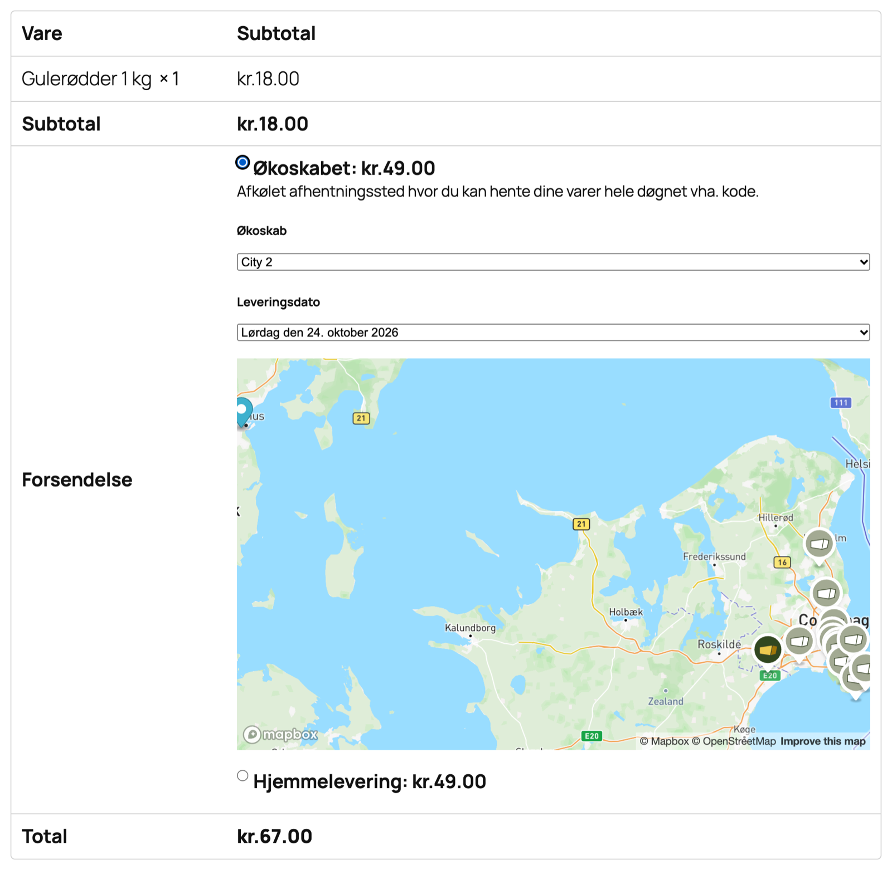
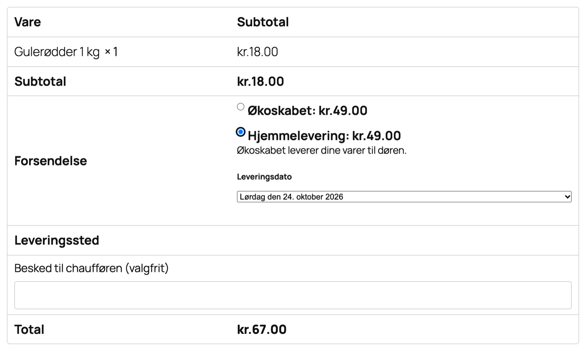
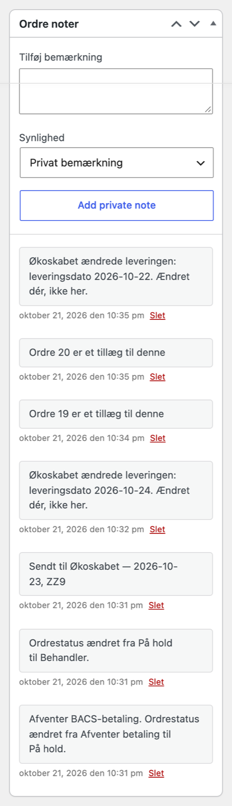

# Kassen og ordrer

Denne del forklarer, hvad kunden ser i kassen, hvornår en ordre bliver sendt til Økoskabet, og hvad pluginet skriver på ordrerne.

## Det ser kunden i kassen

Økoskabets fragtmetoder står mellem butikkens andre fragtvalg, med det navn og den pris, du har givet dem. Når kunden vælger en af dem, kommer valgene for leveringen frem lige under fragtvalgene.

### Økoskabet (skab)

- En kort tekst om skab-levering.
- **Økoskab**: en liste over de skabe, der passer til kundens adresse.
- **Leveringsdato**: de dage, det valgte skab kan få leveret.
- Et kort med skabene. Kunden kan også vælge skab på kortet.

Står **Visning af Plugin** på Modalt, ser kunden i stedet det valgte skab og den valgte dato og knappen **Vælg Økoskab**, som åbner lister og kort i et vindue.

Kunden kan ikke afgive ordren uden skab og dato. Kassen siger "Vælg venligst et Økoskab og en leveringsdato før du afsender ordren."

### Hjemmelevering

- En kort tekst om hjemmelevering.
- **Leveringsdato**: de dage, Økoskabet kører til kundens postnummer.
- Hvor varerne skal stilles: en overskrift, en lille forklaring og en liste over steder med **Andet** sidst. Andet åbner et tekstfelt. Se **Hjemmelevering: Leveringssted** i delen Indstillinger.

Kunden kan ikke afgive ordren uden dato. Undtagelsen er en hjemmelevering med fluebenet **Postnumre uden leveringsdage** til et postnummer uden leveringsdage. Så ser kunden "Leveringsdagen aftales efter bestillingen – vi kontakter dig." og kan bestille uden dato.

### Butiksafhentning

- **Afhentningssted**: butikkens afhentningssteder, som de er sat op hos Økoskabet.
- **Afhentningsdato**: de dage, det valgte sted udleverer.
- Under fragtmetoden står teksten fra metodens felt **Beskrivelse**, for eksempel åbningstider.

Kunden kan ikke afgive ordren uden sted og dato.

### Når der ingen dage er

Kan varerne i kurven ikke leveres på samme dag på grund af dine leveringsundtagelser, viser kassen, hvilke varer der har hvilke regler, for eksempel at en vare kun kan leveres om onsdagen. Under listen står "Du kan fjerne en eller flere af de markerede varer fra kurven for at få flere leveringsmuligheder, eller kontakte os for hjælp."

Har du slået **Tillad opdelt checkout** til, får kunden i stedet knapperne **Opdel levering i to** og **Tøm fra kurven** øverst i kassen. Se Opdelt levering i delen Indstillinger.

### Normal bestilling og Forudbestilling

Indeholder kurven noget, der kan forudbestilles, står to knapper under fragtvalgene: **Normal bestilling** og **Forudbestilling**. Teksten på knapperne bestemmer du under Leveringsundtagelser.

- Hver gang kunden åbner kassen, starter den som en normal bestilling.
- Trykker kunden Forudbestilling, viser datovælgeren forudbestillingsdagene i stedet for de normale dage. I butikker med opdelt levering genindlæses siden.
- Kan hele kurven kun forudbestilles, er knappen Normal bestilling skjult.
- Har du skrevet en tekst til forudbestilling, står den over knapperne, mens forudbestilling er valgt.

### Adresseforslag

**Ny i 1.5.3.** Har du slået **Adresseforslag i kassen** til, foreslår kassen adresser, mens kunden skriver. Er adressen en ejendom med lejligheder, kommer listen **Vælg lejlighed** bagefter.

### Tillæg til en tidligere ordre

**Ny i 1.5.3.** Kassen har feltet **Tillæg til en tidligere ordre? Skriv ordrenummeret her**. Har din kasse allerede sit eget felt til det samme med navnet `billing_order_id`, bruger pluginet det i stedet og tilføjer ikke sit eget.

Skriver kunden nummeret på en tidligere ordre, tjekker kassen:

- at ordren findes og har samme mailadresse som den, kunden skriver i kassen,
- at det er en levering med Økoskabet,
- at ordren stadig kan tage imod mere. Det kan den, så længe bestillingsfristen for leveringsdagen ikke er nået, og Økoskabet ikke er gået i gang med forsendelsen.

Er alt i orden, bliver Økoskabets fragt gratis, fordi varerne kører med i den levering, der allerede er betalt. Er det ikke i orden, ser kunden en af to beskeder lige over fragtvalgene, og ordren bliver en almindelig ordre med sin egen levering og almindelig fragt:

- "Den ordre kan ikke tage imod mere. Dette bestilles for sig, med sin egen levering."
- "Vi kan ikke finde det ordrenummer på din mailadresse. Dette bestilles for sig, med sin egen levering."

## Hvornår en ordre sendes til Økoskabet

Pluginet sender kun ordrer, hvor kunden har valgt en af Økoskabets tre fragtmetoder. Ordrer med butikkens egne fragtmetoder bliver i butikken. Fra version 1.5.3 gælder det også, hvis kunden var inde og vælge et skab, før kunden skiftede til butikkens egen fragt.

En ordre sendes, når den får status **Behandler** eller **På hold**. Det sker normalt af sig selv, når kunden har betalt. Den sendes kun én gang.

- **Behandler**: ordren sendes altid. Sætter du selv en ordre til Behandler, siger du, at pengene er kommet. Sådan kommer en bankoverførsel af sted.
- **På hold**: ordren sendes, hvis den er betalt gennem en betalingsløsning. Mangler den betaling, for eksempel en bankoverførsel kunden ikke har lavet endnu, venter den. Sæt den til Behandler, når pengene er kommet.
- **Annulleret**: er ordren allerede sendt, bliver forsendelsen slettet hos Økoskabet.

Har en ordre med Økoskabets fragt ingen leveringsdato, for eksempel fordi den er oprettet i hånden i WooCommerce, sendes den alligevel og lander blandt de ubehandlede ordrer i Økoskabets backoffice, hvor den får en dato. Det er nyt i version 1.5.3. Før blev sådan en ordre ikke sendt, og der kom ingen note.

### Ændringer efter afsendelsen

Retter du en ordre, efter den er sendt, for eksempel adressen, datoen eller en vare, eller laver du en refundering, sender pluginet ændringen til Økoskabet af sig selv. Afviser Økoskabet ændringen, står det som en note på ordren.

**Ny i 1.5.3.** Flytter Økoskabet en levering i backoffice, for eksempel til et andet skab, en anden dato eller en rettet adresse, skriver pluginet ændringen tilbage på ordren i WooCommerce, når statusbeskeden kommer. Så sender butikken ikke den gamle udgave tilbage næste gang ordren gemmes.

## Det skriver pluginet på ordren

Alle noter er private noter. Kunden ser dem ikke.

- **Sendt til Økoskabet — dato, sted** når ordren er sendt. Stedet er skabets id, "Hjemmelevering" eller "Butiksafhentning". Uden dato står der "uden leveringsdato".
- Afviser Økoskabet ordren, sættes den til **Mislykket**, og Økoskabets begrundelse står som note. Ret fejlen, typisk adressen, og sæt ordren til Behandler igen.
- Noter fra statusbeskeder, når en betaling forsøges hævet, når ordren sættes til **Gennemført**, og når en gennemførelse venter på betalingen.
- Noter om tillæg, se nedenfor.

Leveringsdatoen står også i ordremailen og på kundens ordrebekræftelse som **Leveringsdato**, under leveringsadressen på ordresiden i WooCommerce og på følgesedlen, hvis du bruger pluginet PDF Invoices & Packing Slips. Kundens egen bemærkning til ordren er uændret.

### Hvad der sendes med

Økoskabet får kundens navn, telefon og mail, adressen eller skabet eller afhentningsstedet, leveringsdatoen og ordrens varer. Beskeden til chaufføren er kundens valgte leveringssted og eventuelle tekst, efterfulgt af det, kunden har skrevet i WooCommerces felt **Bemærkninger til ordren**. Butikkens ordrenummer sendes med, så I kan finde forsendelsen i backoffice på det nummer, I kender.

## Statusbeskeder fra Økoskabet

Hver gang en forsendelse skifter trin hos Økoskabet, sender Økoskabet en statusbesked til butikken. Pluginet tjekker underskriften med din **Webhook Secret** og kigger på dine valg:

- Er trinnet et af dine **Capture-events**, forsøger pluginet at hæve betalingen, hvis den ikke allerede er hævet. Resultatet står som note.
- Er trinnet et af dine **Completion-events**, sættes ordren til **Gennemført**, hvis den er betalt og ikke er annulleret, refunderet eller mislykket. WooCommerce sender så sin almindelige mail til kunden.
- Andre trin bliver taget imod og ellers ignoreret.

Standard er at hæve ved **Etiket printet** og gennemføre ved **Udleveret**. Det hele kræver, at **Webhook Status** har flueben.

## Tillægsordrer

**Ny i 1.5.3.**

En tillægsordre er en ny ordre, hvor kunden lægger varer til en ordre, der allerede er bestilt. Den er sin egen ordre i WooCommerce med sin egen betaling, men den får ingen levering for sig. Varerne pakkes og leveres sammen med den første ordre.

Sådan går det:

1. Kunden skriver den første ordres nummer i kassen. Er ordren stadig åben, og vælger kunden en af Økoskabets fragtmetoder, er fragten gratis.
2. Tillægget arver leveringsdato, skab og afhentningssted fra den første ordre. Kunden skal ikke vælge dem igen.
3. Den nye ordre får noten **Tillæg til ordre** og nummeret. Den første ordre får noten **Ordre … er et tillæg til denne**.
4. Når tillægget er betalt, lægger pluginet varerne til den første ordres forsendelse hos Økoskabet. Pakkeriet ser dem nederst på listen med en linje, der begynder med **TILLÆG**. Tillægget får noten **Varerne er lagt til ordre … Ingen selvstændig levering.**
5. Statusbeskeder om den første ordre gælder også tillægget. Når betalingen hæves og ordren gennemføres, sker det samme med tillægget.

Vælger kunden butikkens egen fragt i stedet for Økoskabets, kører tillægget ikke med. Kunden betaler den fragt, og ordren bliver en helt almindelig ordre.

### Når tillægget ikke når med

Bliver et tillæg betalt, efter at leveringen er lukket, typisk en bankoverførsel som markeres betalt dage senere, så kan varerne ikke komme med. Det samme gælder, hvis Økoskabet afviser varerne, eller den første ordre ikke kan læses. Så sætter pluginet tillægget **På hold** med en note om hvorfor og: "Ordren er sat på hold, så butikken kan bestemme: sæt den til Behandler for at prøve igen, eller send eller refundér varerne på anden vis."

### Når tillægget annulleres

Annullerer du et tillæg, tager pluginet varerne af den første ordres forsendelse igen. Tillægget får noten **Varerne er taget af ordre …**.

### Butikkens egen fragtmetode til tillæg

Har butikken sin egen fragtmetode til tillæg, for eksempel en gratis "Tillæg til tidligere ordre", kan du vise den i sin egen række under fragtvalgene med **Fragt i egen række** i indstillingerne. Det er kun visning: metoden ser ikke længere ud som en måde at sende hele ordren på. Den ændrer ikke, hvordan tillægget håndteres. Det er stadig Økoskabets fragtmetoder, der får tillægget med i leveringen.
